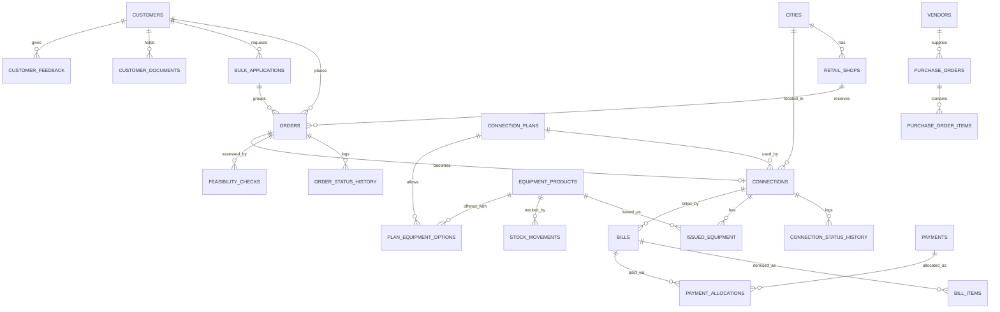

# NEXUS Service Marketing System — Architecture (Node 2 baseline)

| | |
|---|---|
| Version | 1.3 — Node 2 baseline (.NET); the application scaffold exists, no business features or database yet |
| Date | 2026-10-22 |
| Status | BASELINE. All referenced decisions are DECIDED or SUPERSEDED (`decision-log.md`). The stack was changed to ASP.NET Core and SQL Server on 2026-10-22 (D-28). |

## 1. Purpose and scope

A responsive web application that replaces the paper-based records of Nexus Communication System: orders, feasibility, connections and account IDs, equipment and vendors, billing and payments, a customer portal, and search. The MVP scope is in `requirements-matrix.md` (priority M, plus S if time allows).

## 2. Technology stack (D-28)

| Layer | Choice | Reason |
|---|---|---|
| Language and runtime | C# on .NET 10 (LTS) | Required software (.NET); strong typing and a `decimal` type for money |
| Web | ASP.NET Core MVC with Razor views, Bootstrap and JavaScript | Server-rendered pages; fits the course list; responsive with no build step |
| Database | SQL Server 2022 or 2025 (Express or Developer for development; see D-29) | Required software ("or later"); transactions, constraints, sequences, DECIMAL |
| Data access | Entity Framework Core (SQL Server provider) with committed migrations; raw SQL where a statement must be exact (ID counters) | Migrations in version control; parameterised queries by default |
| Auth | ASP.NET Core Identity (cookie sign-in, roles, lockout, password options) | No hand-rolled passwords or sessions |
| Authorisation | Policy-based authorization using a permission matrix kept as data in code, plus scope checks in the data layer | One enforcement point that can be tested exhaustively |
| Files | Private folder outside the web root, served by a permission-checked action with time-limited tokens (Data Protection API) | Customer documents are sensitive |
| Validation | Server-side model validation (data annotations, `ModelState`) plus database constraints | Reject bad input at the boundary |
| Tests | xUnit (domain logic; integration against a disposable SQL Server LocalDB database); Playwright for .NET (end-to-end) | Money, IDs, permissions, full journeys |
| Delivery | GitHub with Actions CI; Windows host (IIS or Kestrel); separate staging and production databases | Matches the required stack |

Decided (D-25, D-28 to D-31): authorisation is enforced in application code with ASP.NET Core Identity roles and policies, never in the browser; the permission matrix lives in code as data and is tested; the application uses one least-privilege SQL login and users have no direct database access. SQL Server row-level security is optional hardening, not part of the MVP. Customer portal logins are created by staff (D-31). Installed baseline (Node 2, pinned by `global.json` and the project files): .NET SDK 10.0.1xx (verified with 10.0.113), net10.0, Microsoft.NET.Test.Sdk 17.14.1, xunit 2.9.3, xunit.runner.visualstudio 3.1.4. Entity Framework Core and the Identity packages are added in Node 3, with versions recorded then.

## 3. Architecture principles

1. **PostgreSQL is the single source of truth.** The UI never decides permissions, trusted IDs or final bill totals.
2. **Server-side authority.** Every protected operation validates role, scope, state transition and input on the server.
3. **Constraints in the database.** Uniqueness (order ID, account ID), foreign keys, CHECK constraints for ID formats and non-negative stock.
4. **Append-only history.** Order status, connection status, feasibility decisions, payments and audit rows are never edited or deleted.
5. **Money is DECIMAL.** No binary floating point for amounts, rates or tax; one documented rounding rule.
6. **Configuration is data.** Plans, prices, validity, deposits, rates, tax, discount tiers and currency are effective-dated rows, not constants.
7. **Private by default.** Customer documents are never public; every access is role-checked and URLs expire.
8. **Small, reversible steps.** One node-sized change at a time, with checks and a commit.

## 4. Role-permission matrix (D-09, D-11)

Legend: ✔ full · R read-only · S scoped (Retail: customers with an order at, or created by, the user's shop, and that shop's orders, connections, bills and payments; Customer: own records) · – no access.

| Capability | Admin | Accounts | Technical | Retail | Customer |
|---|---|---|---|---|---|
| Manage employees and roles | ✔ | – | – | – | – |
| Manage cities, shops | ✔ | R | R | R | – |
| Manage plans, rates, tax, discount tiers | ✔ | R | R | R | R (active plans) |
| Create/edit customer records | R | R | R | S ✔ | S (contact fields only) |
| Create customer portal login (temporary password) | ✔ | – | – | S ✔ | – |
| Desk lookup (exact contact number or account ID, minimal view, any shop) | R | R | R | ✔ (minimal) | – |
| Place an order | – | – | – | S ✔ | – (until D-08 changes) |
| View orders | R (all) | R (all) | R (all) | S | S |
| Cancel an order | ✔ | – | – | S ✔ | – |
| Record feasibility | – | – | ✔ | – | – |
| Create a connection (issues account ID) | – | – | ✔ | – | – |
| Change connection status | – | – | ✔ | – | – |
| View connections | R | R | R | S | S |
| Product catalogue, vendors, purchase orders | ✔ | R (charges only) | R | R (active products, names only) | – |
| Vendor payments | ✔ | – | – | – | – |
| Goods receipt, issue, return, damage | R | R (damage records) | ✔ | – | – |
| Stock corrections (reason required; also opening stock) | ✔ | – | – | – | – |
| Create/edit bills and charges | – | ✔ | – | – | – |
| View bills | R | ✔ | – | S | S |
| Record payments | – | ✔ | – | S ✔ | – |
| View payments | R | ✔ | – | S | S |
| Upload/view customer documents | R | R | R | S ✔ | S (own) |
| Submit feedback | R | – | – | – | S ✔ |
| View audit log | ✔ | – | – | – | – |
| Reports | All | Financial (incl. overdue bills and connections) | Technical (incl. overdue connections, read-only) | Own shop | – |

## 5. Domain model (initial entities)

| Group | Entity | Key fields and constraints |
|---|---|---|
| Identity | `profiles` | ASP.NET Core Identity user (`AspNetUsers`) extended with: role (Identity role, one of 5), link to employee or customer (a customer record has at most one login), active flag, must-change-password flag |
| | `employees` | profile, department, shop (retail only) |
| Organisation | `cities` | 3-char numeric `code` unique, name, active |
| | `retail_shops` | city, name, address, contact, active |
| Customers | `customers` | type (individual/corporate), full name, organisation name (corporate), billing address and city, optional postal code, primary and alternate contact numbers, optional email (required for portal login), address-proof type (no ID numbers stored), created-by shop, nullable `legacy_account_id` |
| | `customer_documents` | customer, kind (address proof/application/receipt), stored file name (private folder outside the web root), year, uploaded by |
| Catalogue | `connection_plans` | type (D/B/T), kind (hourly/unlimited/rental), name, active, `verified` flag |
| | `plan_prices` | plan, amount, currency, validity, hours, effective from/to |
| | `plan_rates` | plan, call type (local/STD/messaging), rate per unit, unit |
| | `plan_equipment_options` | plan, product (eligible equipment; none listed = any active product) |
| | `deposit_rules` | connection type, amount, effective dates |
| | `discount_tiers` | min, max, inclusive flags, percent, effective dates |
| | `tax_configuration` | rate, `deposit_taxable`, effective dates |
| | `settings` | currency, low-stock default, display time zone, `payment_due_days` (default 15) |
| Orders | `orders` | `order_id` unique, type, customer, shop, placed by, plan, status, `channel`, related order, landline reference (T account ID, or legacy identifier flagged `legacy_unverified`), installation address and city, optional `bulk_application_id`, notes (one order = one connection) |
| | `bulk_applications` | customer, created by, created at; group size = count of non-cancelled linked orders |
| | `order_status_history` | order, old, new, actor, time, reason |
| | `feasibility_checks` | order, kind (landline/internet), distance, server available, outcome, reason, actor, time |
| Connections | `connections` | `account_id` unique, order (unique), customer, city, plan, status, start date |
| | `connection_status_history` | connection, old, new, actor, time, reason |
| | `id_counters` | scope (e.g. `order:D`, `account`), last value |
| Equipment | `equipment_products` | name, kind, vendor, optional customer charge, active |
| | `vendors` | name, contact, active |
| | `stock_movements` | product, type (purchase/issue/return/damage/adjustment; adjustment requires a reason), signed quantity, reference, actor, time |
| | `purchase_orders`, `purchase_order_items`, `vendor_payments` | vendor, items, quantities, status, payments |
| | `issued_equipment` | connection, product, quantity, issued at, returned at |
| Billing | `bills` | `bill_number` unique, connection, period, status, due date, rate/tax/discount snapshot, totals |
| | `bill_items` | bill, kind (rental/usage/equipment/adjustment/deposit/discount), description, quantity, unit amount, amount, `is_advance`, `taxable` |
| | `payments` | amount, method, reference, recorded by, shop/office, unique idempotency key, unique `receipt_number` |
| | `payment_allocations` | payment, bill, amount |
| Other | `customer_feedback` | customer, order or connection, rating, comment |
| | `audit_logs` | actor, action, entity, before/after, time |

Physical table and column names follow Entity Framework Core conventions (PascalCase). Money columns are `decimal(18,2)` and rates `decimal(18,4)`.



## 6. Identifier generation (D-01, D-02, D-20)

- **Order ID:** `^[DTB][0-9]{10}$`. Counter scope per letter (`order:D`, `order:T`, `order:B`) by default.
- **Account ID:** `^[DBT][0-9]{15}$` = letter + 3-digit city code + 12-digit serial. Counter scope `account` (one global serial) by default.
- **Mechanism:** inside one database transaction, run `UPDATE id_counters SET last_value = last_value + 1 OUTPUT inserted.last_value WHERE scope = @scope` (the row lock is held until commit), build the ID from the returned value and insert the record. A rollback releases the increment, so there are no gaps for committed records. A unique index and a CHECK constraint on the format are the backstop.
- **Account ID is issued only when the connection is created** from a Feasible order, and is never edited or reused.
- **Consistency checks:** the account ID's type letter must equal the order's type, and its city code comes from the order's installation city.
- **Bill and receipt numbers** (`BL-YYYY-NNNNNN`, `RC-YYYY-NNNNNN`) use per-year counters in `id_counters` with the same lock-increment-insert pattern.
- **Verification:** automated concurrency tests (T-ORD-02, T-CON-02) create 50 records in parallel and assert uniqueness.

## 7. State machines

**Order** (ORD-04). Terminal states: Connection created, Rejected, Cancelled.

| From | Allowed next |
|---|---|
| Submitted | Under review, Cancelled |
| Under review | Feasibility pending, Rejected, Cancelled |
| Feasibility pending | Feasible, Not feasible, Cancelled |
| Not feasible | Rejected, Cancelled (re-assessment is post-MVP) |
| Feasible | Awaiting equipment, Connection created, Cancelled |
| Awaiting equipment | Connection created, Cancelled |

"Rejected" is an administrative refusal (for example invalid documents); "Not feasible" is a technical result with a mandatory reason.

**Who may perform each transition (D-24).**

| Transition | Actor |
|---|---|
| Submitted → Under review | Technical, Admin |
| Under review → Feasibility pending | Technical |
| Feasibility pending → Feasible / Not feasible | Technical |
| Feasible → Awaiting equipment | Technical (advisory: stock insufficient; does not block provisioning) |
| Feasible / Awaiting equipment → Connection created | Technical (provisioning) |
| Under review / Not feasible → Rejected | Admin |
| Any non-terminal state → Cancelled | Admin; Retail for its own shop's orders |

Customers perform no order transitions (D-08).

**Connection** (CON-04). Created as Active. Active ↔ Temporarily inactive. Active or Temporarily inactive → Permanently inactive (terminal). Every change records actor, time and reason.

**Bill** (BIL-14). Draft → Issued → Void (reason required). Unpaid / partly paid / paid / overpaid and overdue are derived from allocations and due date, not stored by hand.

## 8. Billing calculation (D-03, D-07, D-14, D-20)

Decided rule set. Rates and tax remain flagged unverified until confirmed before go-live:

1. Recurring charge: plan rental for the billed period (snapshot of the price at billing time).
2. Usage charges: manually entered minutes × per-minute rate for each call type.
3. Equipment and replacement charges (manual or from the product charge).
4. Adjustments (manual, audited).
5. Bulk discount: tier percent × the `is_advance` rental line and × the security deposit line, each as its own negative bill line. Only the initial bill has an advance line; later bills are not discounted.
6. Taxable base = sum of the lines flagged `taxable` (rental including the advance, usage, equipment, adjustments; the deposit only if `deposit_taxable` is true) minus the discount lines that reduce taxable lines (the advance discount; the deposit discount only if `deposit_taxable`).
7. Tax = taxable base × rate, rounded half-up to 2 decimals, once per bill.
8. Bill total = all charge lines + deposit − discount lines + tax. The advance is part of the rental line, not an additional charge.
9. Amount due = bill total + previous unpaid balance − credits − payments allocated.
10. Due date = issue date + `payment_due_days` (default 15, Admin setting).
11. Refundable deposit balance per connection = deposit actually charged (after discount) − refunds recorded (D-17).

Worked example (TV-T2): rental 350.00 (the advance) + deposit 500.00 in the 10–15 tier (25%): discount lines −87.50 and −125.00; taxable base 350.00 − 87.50 = 262.50; tax 32.13; total 350.00 + 500.00 − 212.50 + 32.13 = 669.63.

Timing (D-14): the initial bill at activation covers the first-period rental (the "advance") plus the security deposit; later bills cover the next validity period's rental in advance plus the previous period's usage in arrears. A bulk-discount tier comes from the size of the order's bulk application (D-03).

All arithmetic uses decimal types (C# `decimal`, SQL Server `decimal(18,2)`; never `float`). The bill stores the plan version, rates, tax rate and discount percent used. Worked test vectors are in `test-plan.md` §4.

## 9. Security and privacy

- Authorisation on the server for every mutation; negative tests for each role (AUTH-02).
- Object-level checks on every read by ID to prevent IDOR (customers, shops, documents, bills).
- Private folder outside the web root; downloads only through a permission-checked action with time-limited tokens; file type and size validation.
- Secrets only in `dotnet user-secrets`, environment variables or the host's secret store; no connection string with a password in Git; the database login used by the application has least privilege.
- Server-side model validation; parameterised queries only (Entity Framework Core or `SqlParameter`); Razor output encoding to prevent XSS; antiforgery tokens on every state-changing request.
- Audit log for sensitive actions; least-privilege named accounts; no shared default credentials at release.
- Public lookup is off by default (D-12).
- Authorisation (D-25, D-28): ASP.NET Core Identity roles with policy-based authorization; the permission matrix is kept as data and tested; scope filters in the data layer; users have no direct database access.
- Document links expire after at most 300 seconds; uploads are limited to PDF, JPEG and PNG up to 5 MB (D-25).
- Passwords are managed by ASP.NET Core Identity (salted hash, minimum length 10, lockout on repeated failures); temporary credentials must be changed at first sign-in (D-31); multi-factor authentication for Admin and Accounts is recommended after the MVP.
- Sign-in cookies are HttpOnly, Secure and SameSite; HTTPS is required outside Development (HSTS).

## 10. Repository layout (Node 2)

```
NexusServiceMarketing.sln
global.json              SDK pin (.NET 10)
Directory.Build.props    shared settings: nullable, warnings as errors, NuGet audit
src/Nexus.Web/           ASP.NET Core MVC application (controllers, views, middleware)
tests/Nexus.Tests/       xUnit tests (unit and integration; Playwright added in Node 12)
tools/Nexus.DocsCheck/   documentation consistency checker
docs/                    the five project documents (plus the audit report)
scripts/verify.ps1       one-command local verification (Windows PowerShell)
.github/workflows/       CI
```

Planned additions: `src/Nexus.Domain` (pure business logic: identifiers, billing, state machines, permissions) and `src/Nexus.Data` (Entity Framework Core context, migrations and data access) are created in Nodes 3–5, when they have content.

## 11. Environments

| Environment | Purpose | Data |
|---|---|---|
| Local | Development (LocalDB or SQL Server Express/Developer) | Synthetic seed |
| Staging | Acceptance testing (Day 14) | Synthetic, labelled demo data |
| Production | Release (Day 15, subject to D-18) | Real data only after owner approval |

## 12. Out of scope and known limits

See `requirements-matrix.md` §5 and `known-issues.md`.
